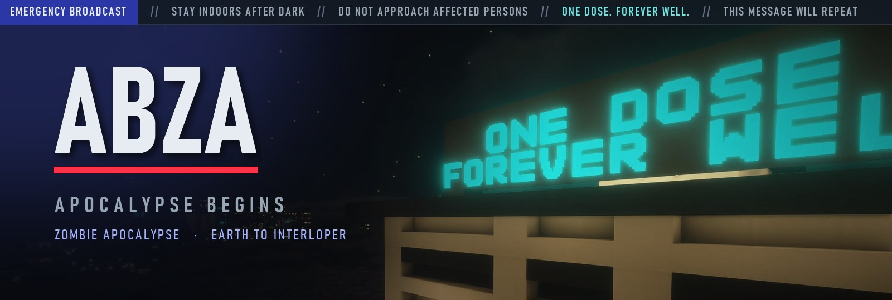
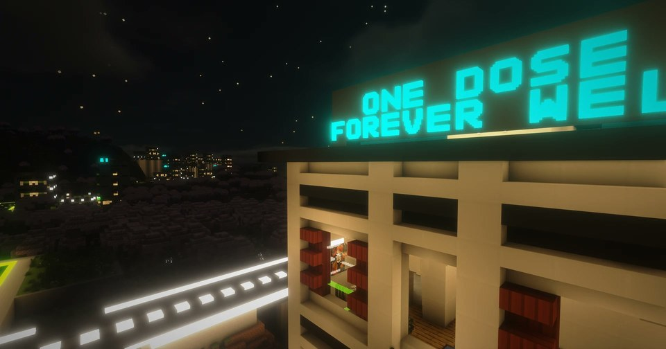
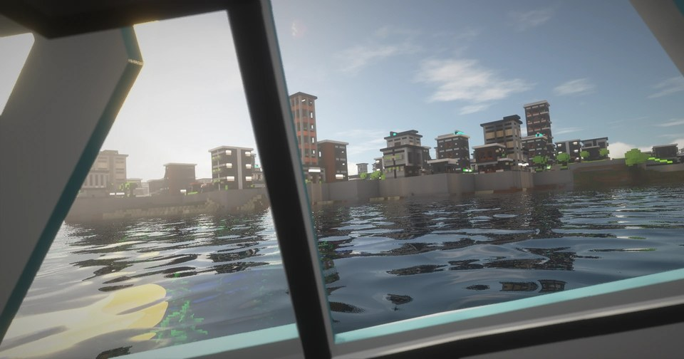
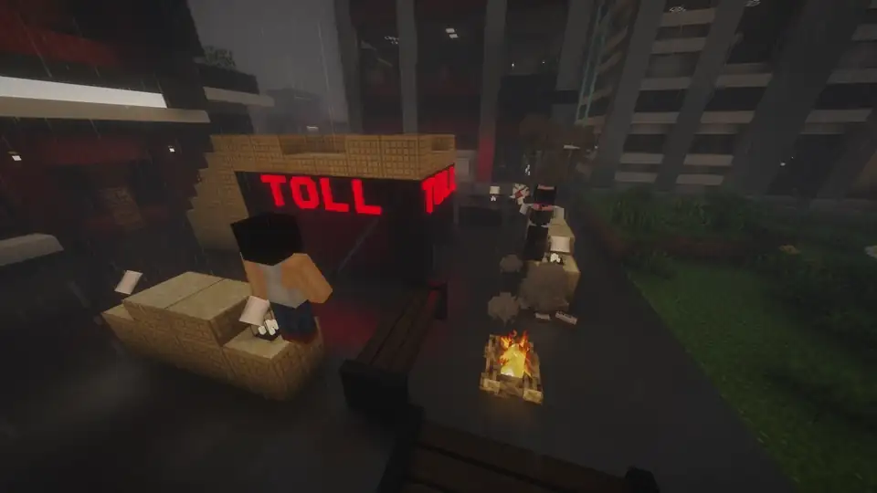
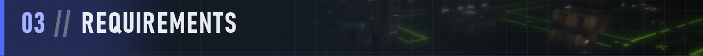

_Explore, Fight, & Conquer apocalyptic worlds with your friends._

> <strong>The Plains, the first tier, are complete.</strong> Every tier is playable; the later tiers' cities come in future versions.

**Extreme PvE survival** on Minecraft 1.20.1 (Forge). The world is split into tiers: each region has its own climate, creatures, weapons and gear. Each tier gets harder the further you go, from <strong>Earth's cities</strong> to <strong>the Moon and four worlds beyond it</strong>.

|                                                                                                                                                                                                                                                                                              |                                                                                                                                                                                                                                                                                         |
| -------------------------------------------------------------------------------------------------------------------------------------------------------------------------------------------------------------------------------------------------------------------------------------------- | --------------------------------------------------------------------------------------------------------------------------------------------------------------------------------------------------------------------------------------------------------------------------------------- |
|  |    |
| <strong>Everwell</strong> One dose. Forever well.                                                                                                                                                                                                                                         | <strong>After Dark</strong> Stay indoors.                                                                                                                                                                                                                                            |
|                      |  |
| <strong>The Plains' City</strong> ABZA's own buildings                                                                                                                                                                                                                                    | <strong>Guards for Hire</strong> Paid by the day, cash first.                                                                                                                                                                                                                                         |

| |
| --- |
|  |
| <strong>Raiders</strong> They want a toll. |

***

*   **Eight tiers:** three tiers on Earth and five tiers in space (1 per planet). Each tier has its own **creatures, mini-bosses, bosses and a final boss**.
*   **Survival:** <strong>no natural healing</strong>; each region's affliction and a **vaccine** made from its creatures. Temperature differs by tier. Food is found, bought or sometimes farmed, but not craftable/cookable.
*   **Combat:** each tier has its own ammunition, vehicles, weapons, and armor. <strong>Hordes attack every fourth night</strong>.
*   **Progression:** a modified **Mekanism** experience changed to integrate Ad Astra and other progression related content.
*   **Scavenging:** locked safes and doors with codes written somewhere nearby, keycard rooms, **air drops** called by flare guns, and more coming soon.
*   **PvE Experience:** every player is on one team, with friendly fire off. A unified world map combined with QoL multiplayer mods will enhance cooperation.
*   **FTB & NPC Quests** with tutorials, story and a bestiary.

***

### The Plains' cities

*   **32 buildings of ABZA's own**, 28 of them also in a darker look: homes, shops and parks, a police station, a clinic, a bank, a marina, and a museum with a boss inside.
*   **Keypad and keycard doors** lock the best rooms; the code or card is usually in the same building.
*   **People live there:** the Survivors' holdout with its traders and guards, a lone trader on a vacant lot, and raiders taking a toll.
*   **Highways** cross the land in long straight lines between the cities.
*   **Prospero:** the yacht with the traders, on the ocean nearest spawn.

### Until the later cities are built

*   **Bosses come to you:** mini-bosses, bosses and final bosses find players in their region, and drop finds from its loot.
*   **Camps:** the first time someone reaches a region, its traders make camp nearby, with guards for hire from the Snow on.
*   **The Alien Navigation Core** drops from the Badlands' final boss and, sometimes, its bosses.

***

## RAM Requirements

| Category          | Minimum | Recommended | Best Experience |
| ----------------- | ------- | ----------- | --------------- |
| DRAM (System RAM) | 4GB     | 8GB         | 12GB            |

## Shader Requirements

| Category               | Minimum | Recommended | Best Experience |
| ---------------------- | ------- | ----------- | --------------- |
| VRAM (Graphics Memory) | 4GB     | 6GB         | 8GB+            |

**Note:** A server requires a minimum of 4GB of RAM, but 8GB or more is recommended for the best experience.

**Need a server?** Check out Wabbanode:

***

## Licence

You are **free** to copy, modify and distribute at your own discretion (BSD Zero Clause).

## Inspiration

**Apocalypse Begins** is **originally** inspired by [DeceasedCraft](https://www.curseforge.com/minecraft/modpacks/deceasedcraft) (author [TqLxQuanZ](https://www.curseforge.com/members/tqlxquanz/projects)).

## This repository

`CLIENT/` is the CurseForge client pack and `SERVER/` the server pack, both at 4.1.0. `CHANGELOG.md` lists what changed in each version.
