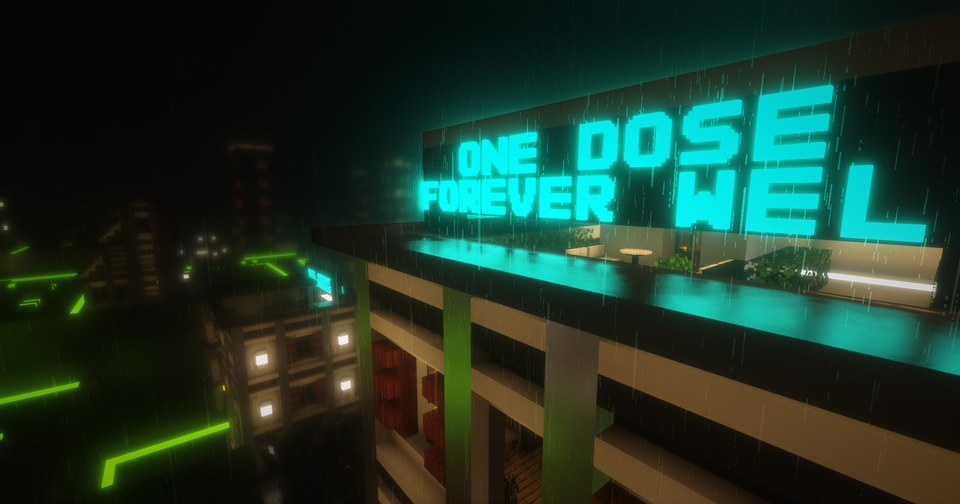
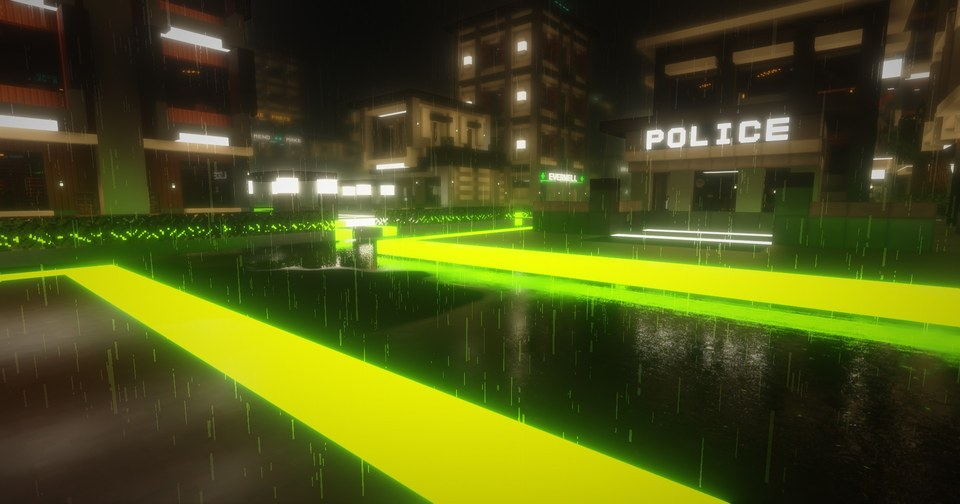
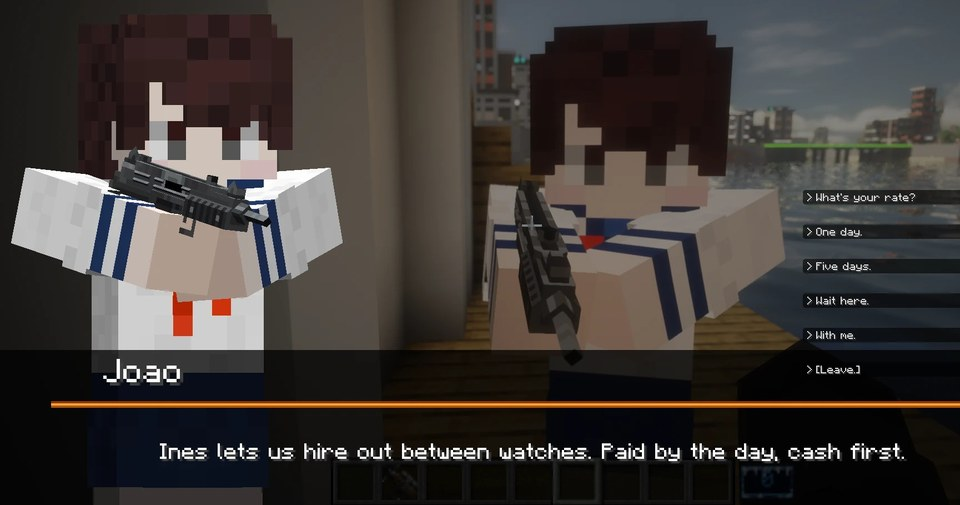
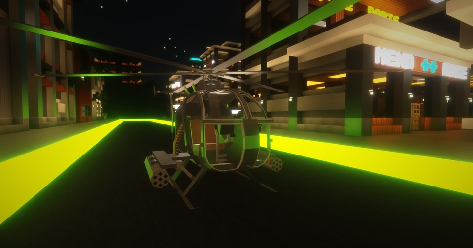
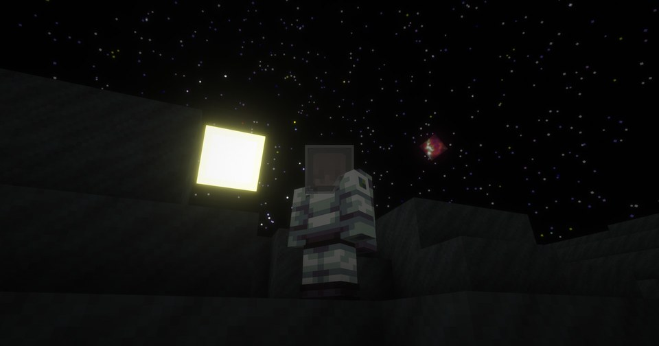
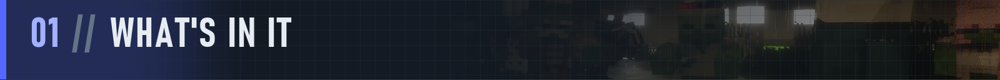
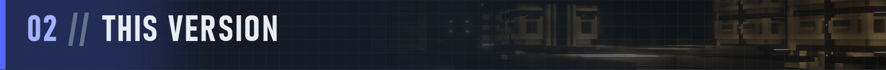

_Explore, Fight, & Survive apocalyptic threats with your friends._

**Extreme PvE survival** on Minecraft 1.20.1 (Forge). The world is split into tiers: each region has its own climate, creatures, weapons and gear. Each tier gets harder the further you go, from <strong>Earth's cities</strong> to <strong>the Moon and four custom worlds beyond it</strong>.

|                                                                                                                                                                                                                                                                                              |                                                                                                                                                                                                                                                                                         |
| -------------------------------------------------------------------------------------------------------------------------------------------------------------------------------------------------------------------------------------------------------------------------------------------- | --------------------------------------------------------------------------------------------------------------------------------------------------------------------------------------------------------------------------------------------------------------------------------------- |
|  |    |
| <strong>Everwell</strong> One dose. Forever well.                                                                                                                                                                                                                                         | <strong>After Dark</strong> Stay indoors.                                                                                                                                                                                                                                            |
|                      |  |
| <strong>Tier 1 City</strong> Futuristic, post-modern style                                                                                                                                                                                                             | <strong>Guards for Hire</strong> Paid by the day.                                                                                                                                                                                                                                         |
|  |  |
| <strong>Vehicles</strong> Each tier has its own. | <strong>Beyond Earth</strong> Five worlds, a tier each. |

***

*   **Eight tiers:** three tiers on Earth and five tiers in space (one per planet). Each tier has its own **creatures, mini-bosses, bosses and a final boss**.
*   **Survival:** <strong>no natural healing</strong>; each region's affliction and a **vaccine** made from its creatures. Temperature differs by tier. Food is found, bought or sometimes farmed, but can't be crafted or cooked.
*   **Combat:** each tier has its own ammunition, vehicles, weapons, and armor. <strong>Hordes attack every fourth night</strong>.
*   **Progression:** a modified **Mekanism** experience changed to integrate Ad Astra and other progression-related content.
*   **Scavenging:** locked safes and doors with codes written somewhere nearby, keycard rooms, **air drops** called by flare guns, and more coming soon.
*   **PvE Experience:** every player is on one team, with friendly fire off. A unified world map combined with QoL multiplayer mods will enhance cooperation.
*   **FTB & NPC Quests** with a map of each tier, story and a bestiary.

***

### Tier 1 City

*   **30+ custom buildings:** homes, shops, parks, and more.
*   **Keypad and keycard doors:** find codes and keycards to access better loot.
*   **Custom NPCs:** you can find survivors, bandits, and more throughout the world.
*   **Story & Lore:** mysteries to solve, NPC quests to complete, and lots of NPC trading, dialogue and more.

***

## RAM Requirements

| Category          | Minimum | Recommended | Best Experience |
| ----------------- | ------- | ----------- | --------------- |
| DRAM (System RAM) | 4GB     | 8GB         | 10GB+            |

## Shader Requirements

| Category               | Minimum | Recommended | Best Experience |
| ---------------------- | ------- | ----------- | --------------- |
| VRAM (Graphics Memory) | 4GB     | 6GB         | 8GB+            |

**Note:** A server requires a minimum of 4GB of RAM, but 8GB or more is recommended for the best experience.

**Need a server?** Check out Wabbanode:

***

## Licence

You are **free** to copy, modify and distribute at your own discretion (BSD Zero Clause).

## Inspiration

**Apocalypse Begins** is **originally** inspired by [DeceasedCraft](https://www.curseforge.com/minecraft/modpacks/deceasedcraft) (author [TqLxQuanZ](https://www.curseforge.com/members/tqlxquanz/projects)). This modpack's progression is inspired by [Once Human](https://www.oncehuman.game/). The custom city design is inspired by [Cyberpunk 2077](https://www.cyberpunk.net/).
