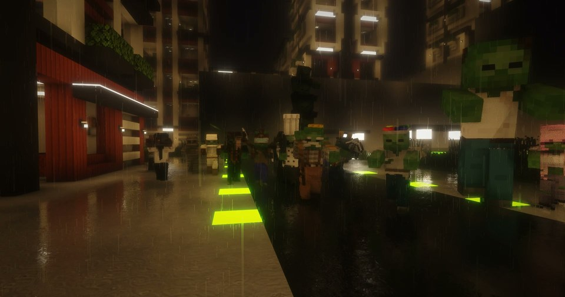
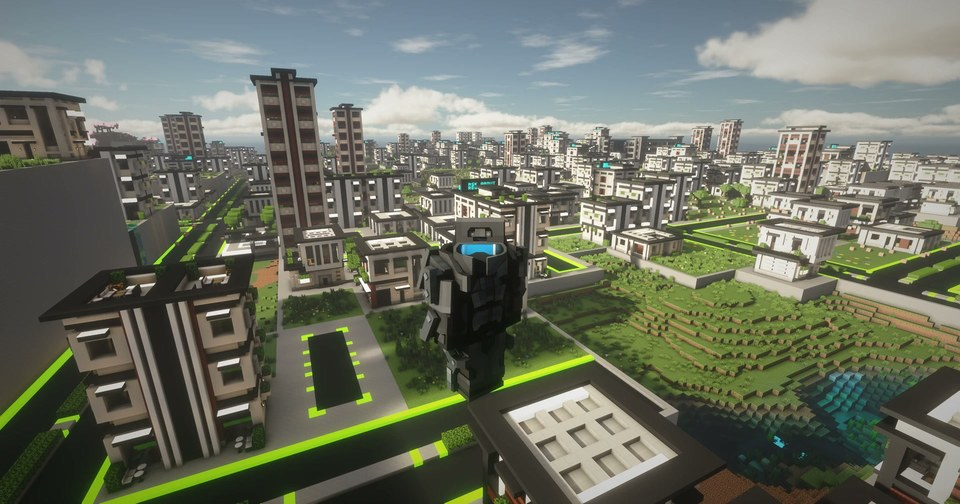
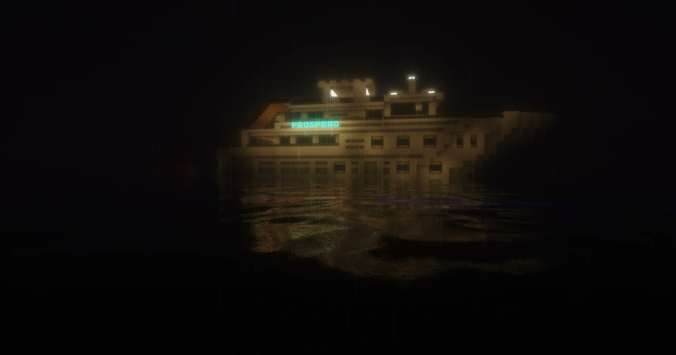
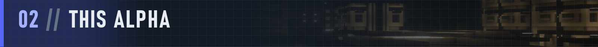

_Explore, Fight, & Conquer apocalyptic worlds with your friends._

> <strong>Currently in alpha and unfinished.</strong> The cities are in development. Expect many changes between versions.

**Extreme PvE survival** on Minecraft 1.20.1 (Forge). The world is split into tiers: each region has its own climate, creatures, weapons and gear. Each tier gets harder the further you go, from <strong>Earth's cities</strong> to <strong>the Moon and four worlds beyond it</strong>.

|                                                                                                                                                                                                                                                                                              |                                                                                                                                                                                                                                                                                         |
| -------------------------------------------------------------------------------------------------------------------------------------------------------------------------------------------------------------------------------------------------------------------------------------------- | --------------------------------------------------------------------------------------------------------------------------------------------------------------------------------------------------------------------------------------------------------------------------------------- |
|  |    |
| <strong>Everwell</strong> One dose. Forever well.                                                                                                                                                                                                                                         | <strong>After Dark</strong> Stay indoors.                                                                                                                                                                                                                                            |
|                      |  |
| <strong>The Plains' City</strong> ABZA's own buildings                                                                                                                                                                                                                                    | <strong>Prospero</strong> The traders' yacht                                                                                                                                                                                                                                         |

***

*   **Eight tiers:** three tiers on Earth and five tiers in space (1 per planet). Each tier has its own **creatures, mini-bosses, bosses and a final boss**.
*   **Survival:** <strong>no natural healing</strong>; each region's affliction and a **vaccine** made from its creatures. Temperature differs by tier. Food is found, bought or sometimes farmed, but not craftable/cookable.
*   **Combat:** each tier has its own ammunition, vehicles, weapons, and armor. <strong>Hordes attack every fourth night</strong>.
*   **Progression:** a modified **Mekanism** experience changed to integrate Ad Astra and other progression related content. 
*   **Scavenging:** locked safes with codes written somewhere nearby, **air drops** called by flare guns, and more comming soon.
*   **PvE Experience:** every player is on one team, with friendly fire off. A unified world map combined with QoL multiplayer mods will enhance cooperation.
*   **FTB & NPC Quests** with tutorials, story and a bestiary.

***

### Current City Related Progress

*   **Tier 1 city:** detached houses, townhouses, bungalows, a corner shop, an apartment tower, a pharmacy, a car park and a plaza.
*   **Prospero:** the yacht with the traders, on the ocean nearest spawn.

### Termporary Features Until The Cities Are Complete

*   **Bosses come to you:** mini-bosses, bosses and final bosses find players in their region, and drop finds from its loot.
*   **Camps:** the first time someone reaches a region past tier 1, its traders and guards for hire make camp nearby.
*   **The Alien Navigation Core** drops from the Badlands' final boss and other bosses.

***

## RAM Requirements

| Category | Minimum | Recommended | Best Experience |
|---|---:|---:|---:|
| DRAM (System RAM) | 4GB | 8GB | 12GB |

## Shader Requirements

| Category | Minimum | Recommended | Best Experience |
|---|---:|---:|---:|
| VRAM (Graphics Memory) | 4GB | 6GB | 8GB+ |

**Note:** A server requires a minimum of 4GB of RAM, but 8GB or more is recommended for the best experience.

**Need a server?** Check out Wabbanode:

***

## Licence

You are **free** to copy, modify and distribute at your own discretion (BSD Zero Clause).

## Inspiration

**Apocalypse Begins** is **originally** inspired by [DeceasedCraft](https://www.curseforge.com/minecraft/modpacks/deceasedcraft) (author [TqLxQuanZ](https://www.curseforge.com/members/tqlxquanz/projects)). 